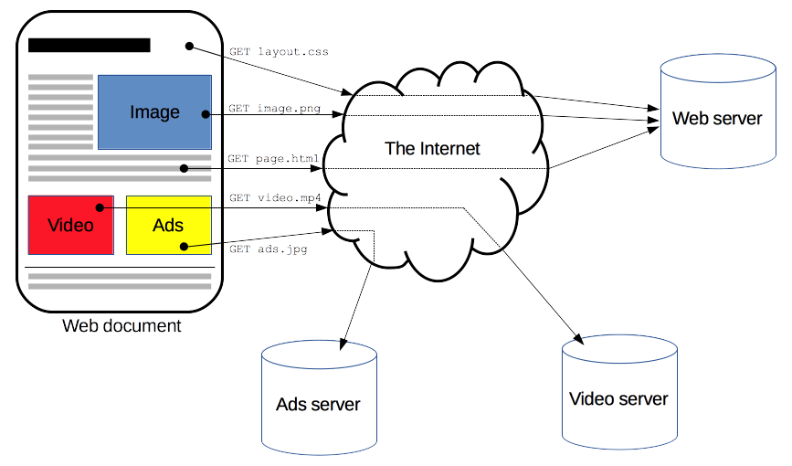
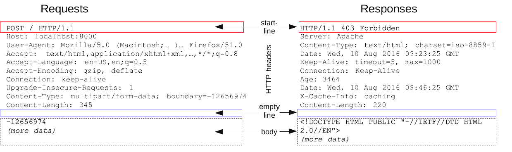

# Http概述

# Http消息

HTTP 请求和响应具有相似的结构，由以下部分组成：

1. 一行起始行用于描述要执行的请求，或者是对应的状态，成功或失败。这个起始行总是单行的。
2. 一个可选的 HTTP 标头集合指明请求或描述消息主体（body）。
3. 一个空行指示所有关于请求的元数据已经发送完毕。
4. 一个可选的包含请求相关数据的主体（比如 HTML 表单内容），或者响应相关的文档。主体的大小有起始行的 HTTP 头来指定。

起始行和 HTTP 消息中的 HTTP 头统称为请求头，而其有效负载被称为消息主体。

---

### 🚀 HTTP 演进总结核心表

| 版本 | 传输层协议 | 核心改进 | 核心痛点/缺点 |
| :--- | :--- | :--- | :--- |
| **HTTP/1.1** | TCP | 开启**长连接** (Keep-Alive) | **队头阻塞 (Head-of-line blocking)**；头部冗余 |
| **HTTP/2** | TCP | **二进制分帧、多路复用**、头部压缩 (HPACK) | TCP 层的队头阻塞（丢包时全队等待） |
| **HTTP/3** | **UDP (QUIC)** | **彻底解决队头阻塞**、0-RTT 握手、连接迁移 | 早期兼容性及防火墙拦截风险 |

---

### 详细解析

#### 1. HTTP/1.1：现代网络的基础
* **长连接**：默认开启 `Connection: keep-alive`，多个请求可以复用同一个 TCP 连接，不用频繁进行三次握手。
* **管道化 (Pipelining)**：虽然允许发送多个请求，但服务器必须**按顺序响应**。如果第一个响应卡住了，后面所有的响应都会被阻塞，这就是著名的 **HTTP 队头阻塞**。

#### 2. HTTP/2：性能的飞跃

* **二进制分帧 (Binary Framing)**：不再传输纯文本，而是二进制帧。这是多路复用的基础。
* **多路复用 (Multi-plexing)**：在一个 TCP 连接里，可以**并行**发送无数个请求和响应，不再需要按顺序排队。
* **头部压缩 (HPACK)**：通信双方维护一张头部表，重复的 Header 不再发送，只发索引，极大减少了流量。
* **服务器推送 (Server Push)**：服务器可以主动把 CSS/JS 发给客户端，不用等客户端请求。

#### 3. HTTP/3：推倒重来
* **QUIC 协议**：基于 UDP。HTTP/2 虽然解决了 HTTP 层的阻塞，但 **TCP 层的阻塞**还在（如果一个包丢了，TCP 会暂停所有流来等重传）。QUIC 实现了即使丢包，也只影响丢失的那一条流。
* **0-RTT 建立连接**：将 TCP 握手和 TLS 握手合并，最快可以在 0 毫秒延迟内开始传输数据。
* **连接迁移**：你在电梯里 WIFI 切换到 5G 时，HTTP/2 连接会断掉（因为 IP 变了），但 HTTP/3 使用 **Connection ID** 识别，连接不会断开，实现无缝切换。

---

### 🗣️ 总结语

> “总的来说，HTTP/1.1 解决了连接复用问题；HTTP/2 通过**多路复用**解决了应用层的队头阻塞和头部冗余；而 HTTP/3 则通过 **QUIC 协议**彻底解决了 TCP 协议栈本身的队头阻塞，并优化了弱网环境下的连接性能。”

**为什么 HTTP/2 解决了队头阻塞，HTTP/3 还要改用 UDP？**

因为 TCP 是一个可靠传输协议，它要求包必须按序到达。在 TCP 层看来，它不知道什么是 HTTP 流，只要有一个包丢了，整个 TCP 窗口都会阻塞。要解决这个问题，必须在 UDP 的基础上自研一套像 QUIC 这样更灵活的传输层协议。